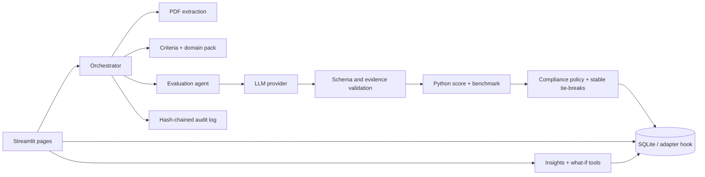

# RFP Compass

RFP Compass is a Streamlit procurement evaluation workbench. It combines proposal text extraction, evidence-grounded LLM judgments, deterministic Python scoring, review workflows, audit history, scenario analysis, and export. The included demo runs locally with a deterministic mock provider and makes no external API calls.

> **Decision support only.** Treat scores and rankings as review aids. Procurement staff must validate evidence, mandatory gates, conflicts, and final award decisions.

## Quick start

Python 3.11 or 3.12 is recommended.

```powershell
python -m venv .venv
.\.venv\Scripts\Activate.ps1
python -m pip install -r requirements.txt
python scripts\seed_db.py
streamlit run app.py
```

Open the local URL printed by Streamlit. Demo mode uses `MockLLM` with no key. To evaluate live, open **LLM Connections**, select a provider, enter a key for the current browser session, test it, then switch off Demo mode. Keys are held in Streamlit session state, excluded from model serialization, and never written into the SQLite database. Clearing the connection or resetting the workspace clears the session value. OpenAI, Anthropic, Gemini, and Cohere keys can also be provided through their standard environment variables. Do not paste real credentials into logs or sample files.

### Connect to more model providers

The provider list includes direct integrations and **LiteLLM · 100+ provider routes**. For the broad LiteLLM catalog, install the optional adapter once with `python -m pip install -r requirements-litellm.txt`, restart Streamlit, choose LiteLLM Universal, then enter the exact `provider/model` route from the [LiteLLM provider catalog](https://docs.litellm.ai/docs/providers). Enter the provider key in the session-only key field, or configure provider-specific credentials through environment variables. Services exposing an OpenAI-compatible chat endpoint can instead use **Custom OpenAI-compatible** with their base URL and any model ID supported by the endpoint. Some providers require account-specific setup, credentials, or endpoint configuration.

### Try the bundled sample proposals

1. In **1 · Setup & criteria**, choose **IT / Software & SaaS** (the default) or **Healthcare / Life Sciences**.
2. Open **2 · Supplier proposals** and select all four PDFs from the matching folder under `sample_data/pdfs/`.
3. Open **3 · Evaluate proposals**, confirm that the files are authorized for processing, and click **Run evaluation**. Keep Offline demo mode enabled for an offline run.
4. Review the results in **4 · Leaderboard** and **5 · Scorecard & evidence**.

Upload only one domain folder at a time. Each folder contains the same four fictional suppliers with different evidence, pricing, and tradeoffs, so the leaderboard comparison is meaningful. The corrupted, empty-text, and image-only files in `sample_data/pdfs/validation_fixtures/` are separate parser tests; they are not normal proposals.

The included proposals are uploadable source documents, not prefilled evaluation results. Each proposal uses the matching template criterion names and includes distinct evidence, limitations, and pricing. The generated offline preview JSON is for technical inspection only; use the upload steps above to create a normal evaluation run. All suppliers and claims are fictional.

To try a scoring template, open **1 · Setup & criteria → Use an existing scoring template**, upload one JSON file from `sample_data/templates/`, review the proposed criteria, then apply it. Each template starts with a 60% generic / 40% domain-specific split and totals 100%. For the smoothest demo, use `it_software_saas.json` with the IT/SaaS proposal PDFs, or `healthcare_life_sciences.json` with the healthcare PDFs. The seven templates are importable criteria lists; choose the matching domain PDFs separately.

## What is included

- Eleven Streamlit workspace views: setup, suppliers, evaluate, leaderboard, scorecard, compare, what-if, insights, audit, run details/export, and LLM connections.
- Seven editable YAML domain packs: IT/SaaS, healthcare/life sciences, financial services, construction/infrastructure, manufacturing/supply chain, professional consulting, and generic procurement.
- CSV, XLSX, JSON, YAML, DOCX, and PDF criteria-template parsing with review before applying.
- Direct adapters for OpenAI-compatible services, Anthropic, Gemini, Cohere, and deterministic mock evaluation, plus an optional LiteLLM route for a broad catalog of hosted, cloud, gateway, and local providers. Model IDs remain free-form; custom OpenAI-compatible endpoints work without LiteLLM.
- PDF extraction with page references and image-only/scanned document warnings. OCR is not included.
- Review queue, score overrides with rationale, comments, criteria snapshots, run finalization, audit-chain verification, PDF/XLSX/JSON exports, and backup/restore.
- Deterministic what-if analysis with normalized weights and seeded Monte Carlo simulation.
- Synthetic proposal PDFs for two domains, parser edge fixtures, seven sample templates, and a sanitized offline sample run under `sample_data/`.

## Architecture and data flow



The evaluator asks the selected provider for criterion-level judgments and evidence. Python checks the response schema, drops unknown criteria, clips out-of-range scores, verifies quotes against extracted page text, fills missing criteria with zero, and routes unclear mandatory gates for review. Python then calculates weighted scores, peer metrics, and the ranking. LLM prose never performs arithmetic or chooses the final rank.

Key modules:

| Area | Code |
|---|---|
| Streamlit entry and pages | `app.py`, `rfp_compass/ui/pages/` |
| Workflow | `rfp_compass/orchestrator.py` |
| Provider interface and diagnostics | `rfp_compass/llm/` |
| Agents and prompt templates | `rfp_compass/agents/`, `rfp_compass/prompts/` |
| Deterministic domain tools | `rfp_compass/tools/` |
| Migrations and persistence | `rfp_compass/db.py`, `rfp_compass/tools/persistence_tool.py` |
| Domain configuration | `domain_packs/*.yaml` |

## Scoring and ranking

For criterion `i`, with score `sᵢ` on maximum `mᵢ`, and weight `wᵢ` expressed as percentage points:

`absolute score = Σ ((sᵢ / mᵢ) × wᵢ)`

For example, a score of 8/10 at 60% and 5/10 at 40% yields `8/10 × 60 + 5/10 × 40 = 68/100`.

Peer performance index (PPI) is the weighted average of each supplier’s percentage of the best score on each criterion. If all suppliers score zero on a criterion, each receives 100% for that criterion, avoiding division by zero. Rankings sort by:

1. Mandatory-gate compliance (compliant first)
2. Higher PPI
3. Earlier submission date
4. Higher experience rating
5. Supplier name ascending (case-insensitive)

This is a deterministic policy choice for the demo, not a universal procurement rule. Adjust it to local policy before operational use.

## Domain packs and criteria templates

Each YAML pack has a `domain_id`, name, description, version, optional `weight_split`, `generic_criteria`, `domain_criteria`, `gates`, and a prompt addendum. In Setup, choose **Generic criteria + my uploaded template**, upload and review the template, set the generic/template percentage split, and inspect the combined preview before applying. Template rows that match a built-in generic criterion update that row instead of creating a duplicate. The split slider redistributes each group while preserving proportions within that group. Template-only and custom scorecards are also available. Active weights must total 100% before evaluation. Gate definitions should state an objective pass rule and evidence requirement.

For a simple starting point, use the Excel starter from **Setup → Use an existing scoring template**. The workbook has example criteria plus a Read me sheet. Keep one criterion per row, and make the Weight (%) column total 100%. CSV, Excel, JSON, and YAML imports do not need an LLM. PDF and Word imports require a tested live provider and explicit consent before template text is sent. Review every imported criterion and gate before applying it. Domain packs are prompt configuration, not legal or regulatory advice.

For OpenAI, create an API key in the [OpenAI developer platform](https://platform.openai.com/api-keys); a ChatGPT login or Plus subscription is not an API key, and API usage is billed separately. Enter the exact model ID or deployment name supported by your account and endpoint; the app does not constrain model choices. Test the connection and assign it for evaluation before running proposals.

To add a domain, add `domain_packs/<domain_id>.yaml`, include criteria and gates, then run `python scripts/seed_db.py`. The Setup page can load or select the pack. Add focused tests for its weight split and gate behavior.

## Synthetic data and demos

Regenerate all fixtures with:

```powershell
python scripts\generate_synthetic_rfps.py
python scripts\run_validation_demo.py
```

All supplier names, prices, certifications, and proposal claims are fictional. The sample PDFs now answer each matching template criterion under the same heading, with explicit commitments, trade-offs, and page-level evidence. Import the matching JSON template, apply it, upload all four PDFs from that domain folder, then evaluate with Offline demo mode or a tested live provider. The LLM prompt uses a shared 0–10 calibration and requires concise, verbatim, page-cited evidence. Provider outputs can still differ; review scores and gates before relying on them. `scripts/generate_sample_run.py` creates an offline MockLLM run for technical walkthroughs. The validation demo shows score clipping, unknown criterion removal, missing-criterion defaults, and unsupported evidence warnings. `sample_data/pdfs/validation_fixtures/` contains corrupted, empty-text, and image-only PDFs for parser demonstrations. See `sample_data/README.md` for upload pairings and expected supplier trade-offs.

## Privacy, security, and operational assumptions

- SQLite is the default and is created locally at `rfp_compass.sqlite3`. It is suitable for a single-user demo and may be ephemeral on hosted Streamlit instances.
- Provider keys are session-only. Audit records store salted key fingerprints and provider metadata, not raw keys. Logs use common provider-key redaction patterns.
- Supplier PDFs and extracted text are sent to the selected provider when live evaluation is enabled. Review that provider’s data retention, processing region, contract, and privacy terms first.
- Local SQLite and uploaded documents are not encrypted at rest by this app. Apply host-level encryption, access controls, retention, and backup policy for real procurement data.
- Endpoint validation blocks private and metadata destinations by default for custom URLs; local endpoints require an explicit opt-in. Network environments may still enforce additional egress controls.
- The role selector supports workflow behavior in the prototype; it is not a full authentication or authorization system. Put the app behind an identity-aware gateway before multi-user deployment.
- PDF OCR is not built in. Image-only proposals are flagged and may produce incomplete or empty evaluations; convert them with an approved OCR workflow before evaluation.
- Price estimates are approximate and only available for models with a configured rate in `rfp_compass/llm/pricing.py`. Unknown model pricing is reported as unavailable.
- The database adapter extension point accepts a SQLite-compatible connection factory. A remote service must support the SQL/schema behavior used here, row objects with named and positional access, and transaction methods. PostgreSQL is not drop-in compatible with this schema.

### Optional remote database adapter

SQLite is the only built-in adapter. To plug in a SQLite-compatible remote client (for example, a Turso client wrapper), set:

```text
RFP_COMPASS_DB_ADAPTER=custom
RFP_COMPASS_DB_ADAPTER_FACTORY=my_adapter:connect
RFP_COMPASS_DB=<adapter path or URI>
```

The factory receives the configured path/URI and returns a connection implementing `execute`, `commit`, `rollback`, `close`, and SQLite-like row access. The normal migrations run through that connection. Implement and integration-test the adapter for your vendor’s transaction, concurrency, foreign-key, and migration behavior before using it; no remote database credentials or vendor connector are bundled.

## Testing and local checks

```powershell
pytest -q
python -m compileall -q app.py rfp_compass scripts
```

Tests run offline and do not require provider credentials. App smoke check in a Python shell:

```python
from streamlit.testing.v1 import AppTest
app = AppTest.from_file("app.py", default_timeout=20).run()
assert not app.exception
```

## Streamlit Community Cloud deployment

1. Push this project to a GitHub repository. Keep `.streamlit/secrets.toml` and any real keys out of version control; only the example file is safe to commit.
2. In Streamlit Community Cloud, create an app for the repository and select `app.py` as the entry point.
3. Use Python 3.11 or 3.12 and install from `requirements.txt`.
4. Deploy and confirm that the app starts in Demo mode. No secret configuration is needed for the mock provider.
5. For live provider use, add credentials through the LLM Connections page for the active session, or configure a secret manager only if you deliberately modify the app to read it. Keys entered in the UI are not retained after the session ends.
6. Use **Run Details & Export** to save backups when needed. Community Cloud local storage can be reset during rebuilds or restarts; use a tested remote adapter for durable storage.
7. Restrict access to authorized evaluators, review the provider data path, and validate all gates and evidence before award decisions.

For a private network endpoint, verify the deployment’s network access and leave private-network opt-in disabled unless the endpoint is trusted and intentionally reachable.

## Screenshots

Add deployment-specific screenshots here after launching the app. Suggested captures: `setup.png`, `leaderboard.png`, `scorecard.png`, and `llm-connections.png`. Screenshots are intentionally not fabricated from static mockups.

## License and use

No license is specified. Add the license appropriate to your organization before distributing the project. This prototype is supplied for evaluation and demonstration; have procurement, security, legal, and accessibility stakeholders review it before operational use.
